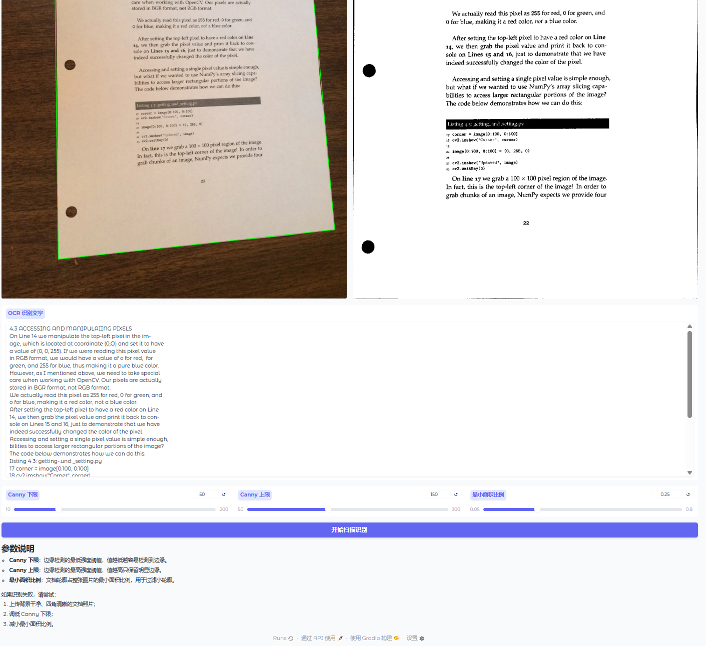

# OpenCV Document Scanner with RapidOCR
基于OpenCV实现文档透视矫正 + RapidOCR文字识别，Gradio可视化网页前端。
> 拍照文档自动拉直、二值化增强、提取文字，适合作业、试卷、纸质资料电子化。

## 📸 效果预览



## ✨ 功能特点
- 文档边缘检测，自动寻找纸张四边形轮廓
- 透视变换矫正倾斜文档（扫描效果）
- OTSU自动二值化，增强文字对比度
- RapidOCR离线文字识别，不需要联网
- Gradio可视化网页界面，支持参数滑动调节
- 输出：轮廓图、矫正扫描图、识别文本
- 识别失败友好提示

## 📦 环境依赖
Python >=3.8
```bash
pip install opencv-python numpy gradio rapidocr-onnxruntime

## 📝 使用说明
1. 上传文档图片，保证文档四个角完整可见，背景尽量干净
2. 按需拖动滑块调整参数
    - Canny下限：边缘弱阈值，数值越低越容易检出边缘
    - Canny上限：边缘强阈值，只保留明显边缘
    - 最小面积比例：过滤微小噪点轮廓
3. 点击【开始扫描识别】
4. 查看轮廓图、矫正扫描图、OCR识别结果

## 🛠 技术栈
OpenCV | NumPy | Gradio | RapidOCR

